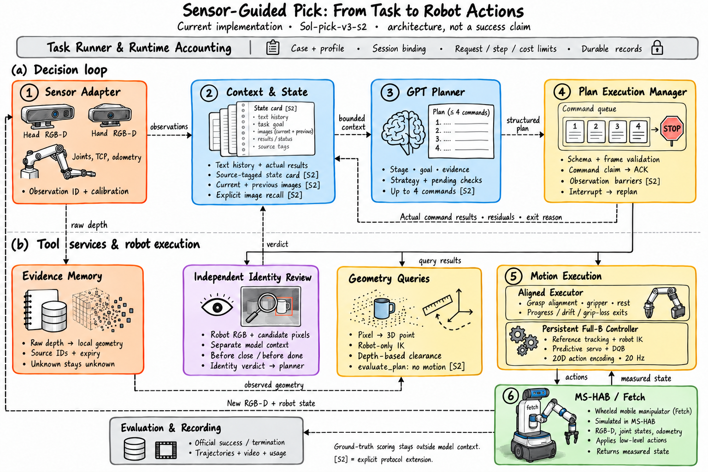

# Astra Pick：传感器驱动的机器人任务闭环

Astra Pick 在 MS-HAB 中控制 Fetch 移动机械臂完成 Pick 任务。GPT 根据机器人自身的 RGB-D、关节状态和相对里程计选择目标、站位与抓取动作；系统执行模型提出的工具命令，并将新观测和实际执行结果送回模型。

系统包含两个闭环：**外层由 GPT 根据证据修订计划，内层由持续运行的控制器根据实测状态跟踪动作。** 身份复核与几何查询是按需调用的工具服务，官方评分在独立评估侧完成。

本目录提供用于阅读和复核方法的代码，不能独立运行。MS-HAB／ManiSkill 环境、包装纹理资产和模型服务接入不包含在此目录中。

## 系统结构

图按职责划分模块，不与 Python 文件一一对应。工具服务独立调用，结果进入下一轮上下文；它们不是必须依次经过的流水线。图中的机器人和相机画面是示意插图。

本文以代码中的 `Sol-pick-v3-s2` 配置说明完整链路。图中 **[S2]** 标记阶段计划、分来源状态卡、短命令队列及图片窗口等配置扩展。架构图描述实现，不作为任务效果或成功率的证据。包名保留 Astra Pick；具体模型由所选 profile 决定。

## 一个任务如何执行

### 1. 初始化任务与持续会话

任务入口读取案例与 profile，创建环境、传感器和执行端口。每个任务拥有独立的策略状态、响应会话、深度缓存与 Full-B 控制器会话。多个工具命令共用持续的控制状态，不在每次模型决策时重置控制器。

环境初始化数据与模型输入分开。模型获得目标语义描述，不能读取目标在场景中的真实位置。

### 2. 采集并绑定机器人观测

传感器适配器读取头部和手部 RGB-D、关节位置与速度、FK 计算的 TCP 位姿和相对里程计，并记录观测 ID 与相机标定。

深度显示图供模型查看，原始毫米深度供工具计算。像素定位使用模型指定的像素、深度和相机标定；机器人移动使观测失效后，旧像素不能继续充当当前测量。

### 3. 构建上下文

上下文包括任务目标、机器人说明、工具契约、文本历史、实际执行结果与状态卡。状态卡区分机器人测量、工具证据、模型自述和待确认项。模型声称持有物体，不会直接转成持有事实。

S2 默认提供当前与上一组 RGB-D。显式调用 `recall_observation` 后，下一请求才额外加入指定历史图。图片窗口模式显式重建输入，使用 `store=false`，不依赖 `previous_response_id`。

### 4. 模型提出带证据的短计划

GPT 输出阶段、目标、证据引用、策略、待检查项和工具参数。完整 S2 配置每次最多提出四条命令。

`search / confirm / stance / grasp / exit / rest` 是计划的阶段标签，不是固定执行顺序。看哪里、选择哪个候选、如何站位与抓取、何时重新观察，由模型决定。

### 5. 校验并执行命令前缀

执行管理器校验 schema、观测引用、状态版本和坐标来源。每条命令执行前记录 claim，完成后记录 ACK 和实际结果。

观察关口、运动受阻、底盘偏移、资源限制或未知执行结果会中止剩余命令。已执行与未执行的命令分开反馈；系统不会把提出过的策略记录成已经尝试，也不会自动改写无效命令。

### 6. 查询证据或执行动作

执行管理器按需调用独立身份复核、几何查询或运动工具。查询可以不推进物理时间；运动命令进入对齐执行器和持续控制器。

对齐执行器处理抓姿绑定、闭爪条件、收臂与异常退出。Full-B 控制器根据实测状态跟踪参考轨迹，运行机器人 IK、预测伺服和扰动观测，并生成 **20 维动作，以 20 Hz 控制频率执行**。获得实际执行确认后才推进步数。

### 7. 反馈、重规划与结束

实际动作、到位状态、残差与退出原因进入下一轮上下文。GPT 结合新 RGB-D 决定换视角、改站位、调整抓姿或结束。

`done` 和 `give_up` 是模型结束请求。官方停止、资源限制与基础设施异常也可能结束任务。官方成功单独评分，不由模型声明、夹爪关闭或末端到位替代。

## 模块与代码入口

| 模块 | 职责 | 阅读入口 |
|---|---|---|
| Task Runner | 案例、环境、profile、端口和任务生命周期 | [run_case.py](src/astra_pick/run_case.py)：`live_run`、`new_attempt_state`、`run_with_ports` |
| Sensor Adapter | RGB-D、机器人状态、观测 ID、标定与深度缓存 | [run_case.py](src/astra_pick/run_case.py)：`observe`；[sensing.py](src/astra_pick/robot/sensing.py)：`ObservationDepth` |
| Context & State | 上下文、历史图窗口、分来源状态卡 | [pick.py](src/astra_pick/pick.py)：`build_s2_wire`；[memory.py](src/astra_pick/memory.py)：`plan_state_card` |
| Planner 协议 | 阶段计划、命令参数和证据引用 | [pick.py](src/astra_pick/pick.py)：`s2_plan_schema`、`s2_validate_plan` |
| Plan Execution Manager | 逐命令校验、claim/ACK、观察关口与中断 | [pick.py](src/astra_pick/pick.py)：`s2_advance`；[run_case.py](src/astra_pick/run_case.py)：`execute_s2_plan` |
| Independent Identity Review | 用独立模型上下文复核候选身份 | [pick.py](src/astra_pick/pick.py)：`r2a_comparison_wire`、`dispatch_r2a_identity` |
| Geometry Queries | 像素反投影、机器人可达性、观测几何的路径余量 | [executor.py](src/astra_pick/robot/executor.py)：`check_path`、`check_clearance` |
| Evidence Memory | 局部观测几何及来源、时效管理 | [memory.py](src/astra_pick/memory.py)：`EpisodeMemory`；[clearance.py](src/astra_pick/robot/clearance.py)：`SensorClearance` |
| Aligned Motion Executor | 抓姿、对齐、夹爪、收臂与退出条件 | [executor.py](src/astra_pick/robot/executor.py)：`AlignedFullBOnlineExecutor` |
| Persistent Full-B Controller | 跨命令跟踪、预测伺服和动作编码 | [fetch_episode.py](controller/full-stack/fetch_episode.py)、[fetch_tracker.py](controller/full-stack/fetch_tracker.py)、[fetch_driver.py](controller/full-stack/fetch_driver.py) |
| Runtime Accounting | 请求准入、资源计数、交付状态与回执 | [pick.py](src/astra_pick/pick.py)：`ResponseSession`、`_process_session` |
| Evaluation & Recording | 官方评分、逐步轨迹、录像和用量记录 | [run_case.py](src/astra_pick/run_case.py)：`strict_pick` 与逐步记录路径 |

`pick.py` 承载多项策略层职责，`run_case.py` 将它们连接到实际端口。Detector、Navigate、Manipulation 等功能分组名不代表三个独立模型。

`controller/` 包含底层控制实现，`src/bvi/pick_system/` 和 `scripts/` 包含相关快照辅助代码。阅读控制链时，应同时查看包内执行器与 `controller/full-stack/`。公开目录是方法阅读布局，不能直接作为已配置好的运行环境使用。

## 工具能力与边界

| 工具 | 提供的能力 | 不能据此推断 |
|---|---|---|
| `locate_point` | 将指定像素反投影为机器人基座坐标中的点 | 自动分割、完整物体位姿或身份正确 |
| `check_path` | 使用机器人自身模型检查运动学可达性 | 场景无碰撞 |
| `check_clearance` | 用观测深度几何预览路径余量 | 未观察区域为空或路径一定安全 |
| `evaluate_plan` | 零物理步执行一组候选查询 | 候选已经被执行 |
| `verify_target` | 用原始机器人 RGB、候选像素和外观描述独立复核 | 目标选中或抓取完成就代表身份正确 |
| `look / move_base` | 执行指定视角或底盘运动 | 自动完成全局导航 |
| `prepare_grasp / replan_grasp` | 执行并更新模型给定抓姿，进行对齐 | 控制器自行选择语义目标 |
| `move_to / move_eef_chunk` | 跟踪一个或一组末端位姿 | 动作到位就等于任务完成 |
| `set_gripper / return_to_rest` | 执行夹爪或收臂动作并反馈状态 | 闭爪就代表持有，收臂就代表成功 |

身份复核用于闭爪前和结束前的检查，并与主规划上下文分离。几何记忆保存带来源和有效期的观测，S2 状态卡汇总决策证据；两者职责不同。未知或过期几何不能被视为自由空间。

常规闭爪的严格对齐门与显式受阻闭爪分支分别处理，不应概括为全局放宽到位条件。深度 clearance 提供证据，计划管理器可能因此要求重新决策，但它不是场景真值碰撞检查。

## 信息与评估边界

| 进入模型上下文 | 留在评估侧或不提供给模型 |
|---|---|
| 机器人头／手 RGB-D、关节、TCP、相对里程计 | 物体世界位姿、场景碰撞网格、官方 navmesh |
| 目标语义、机器人自身 FK／IK 结果 | 由场景真值筛选出的候选位置 |
| 工具结果、实际残差、退出原因和资源余量 | 官方抓持标志、接触体身份、第三人称调试画面 |

控制器使用机器人测量及允许的停止/rest 标志，不将整个模拟器 info 作为模型观测。官方 `strict_pick` 在评估侧检查抓持、末端与机器人休息状态、静止状态及力约束。任务评分与模型结束理由分别记录。

## 配置组织

| 配置 | 接口差异 |
|---|---|
| `Sol-pick-v3-lean-s1.3` | S2 继承的执行层 |
| `Sol-pick-v3-s2a` | 阶段计划与分来源状态卡 |
| `Sol-pick-v3-s2b` | 最多四条命令的短队列与 `evaluate_plan` |
| `Sol-pick-v3-s2` | 当前／上一组图片窗口与显式历史图召回 |

配置组合定义在 [pick.py](src/astra_pick/pick.py)，基础配置与提示资源见 [profiles.json](src/astra_pick/profiles.json) 和 [prompt.md](src/astra_pick/prompt.md)。具体行为以选定 profile 和请求构建函数为准，不能把所有历史开关同时视为启用。

本文说明系统设计和代码结构，不报告实验成功率。实现检查、CPU 验证与原生任务效果是不同层面的证据。
